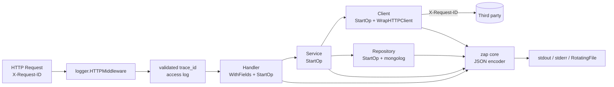
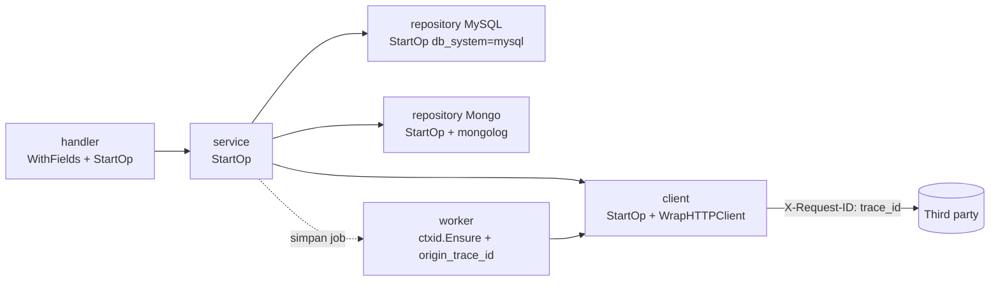

# logger — Dokumentasi Teknis

Package: `github.com/go-dto/go-common/logger`
Basis: [`go.uber.org/zap`](https://github.com/uber-go/zap) v1.28
Dependency tambahan: `github.com/felixge/httpsnoop` untuk menjaga interface `http.ResponseWriter` saat merekam access metrics. Sub-package `mongolog` memakai `go.mongodb.org/mongo-driver` (hanya ikut ter-compile jika `mongolog` di-import).

---

## Daftar Isi

1. [Ringkasan](#1-ringkasan)
2. [Struktur Package](#2-struktur-package)
3. [Quick Start](#3-quick-start)
4. [Konfigurasi](#4-konfigurasi)
5. [Format Output](#5-format-output)
6. [Konvensi Field](#6-konvensi-field)
7. [Context Propagation](#7-context-propagation)
8. [Redaksi Data Sensitif](#8-redaksi-data-sensitif)
9. [Rotasi File](#9-rotasi-file)
10. [Mengubah Level Saat Runtime](#10-mengubah-level-saat-runtime)
11. [API Reference](#11-api-reference)
12. [Testing](#12-testing)
13. [Migrasi dari `singleton`](#13-migrasi-dari-singleton)
14. [Best Practice](#14-best-practice)
15. [Troubleshooting](#15-troubleshooting)
16. [Tracing Lintas Layer](#16-tracing-lintas-layer)
17. [Contoh Implementasi Production](#17-contoh-implementasi-production)

---

## 1. Ringkasan

`logger` adalah library logging terstruktur untuk service Go. Tujuannya: log yang konsisten, aman (tidak membocorkan data sensitif), dan bisa diandalkan di production.

| Fitur | Keterangan |
|---|---|
| Global logger thread-safe | Disimpan di `atomic.Pointer`, aman dipakai banyak goroutine dan aman di-init ulang |
| Default aman | Bisa dipakai sebelum `Init` (JSON ke stdout, level info) |
| Konfigurasi via env | Divalidasi di awal; nilai salah → error, bukan diabaikan |
| Field statis | `service`, `env`, `version` di setiap baris |
| Tanpa sampling (default) | Tidak ada log yang dibuang diam-diam saat traffic tinggi |
| Context propagation | `trace_id` otomatis + field bisnis via `WithFields` |
| Redaksi | Body JSON/form, URL, header |
| Rotasi file | Per ukuran / harian, max backup, max age |
| Level runtime | `SetLevel` atau endpoint HTTP `LevelHandler` |
| Redirect stdlib `log` | `log.Printf` ikut jadi JSON terstruktur |
| Tracing lintas layer | `StartOp` per function (handler → service → repository → client) dengan `span_id`, `parent_span_id`, `layer`, `op`, `duration_ms`; error dicatat sekali |
| HTTP inbound | Middleware request-ID tervalidasi + access log status, durasi, ukuran response, dan panic |
| HTTP outbound | `WrapHTTPClient` meneruskan `X-Request-ID` ke third party + log setiap hit |
| MongoDB | `mongolog.NewMonitor` log setiap command dengan `trace_id` dari ctx |
| Backward compatible | Package `singleton` lama tetap jalan |

---

## 2. Struktur Package

```
logger/
├── doc.go                  # dokumentasi package (godoc)
├── config.go               # Config, DefaultConfig, ConfigFromEnv, ConfigFromLookup, Validate
├── logger.go               # New(cfg) → *Instance, encoder, konstanta key
├── global.go               # Init, L, S, Named, Sync, Close, SetLevel, GetLevel, Enabled, LevelHandler, AddHook, ReplaceForTest
├── context.go              # WithFields, FieldsFromContext, FromContext / Ctx, SugarFromContext
├── redact.go               # Redactor + helper field (SafeURL, SafeJSON, ...)
├── rotate.go               # RotatingFile (WriteSyncer + rotasi)
├── op.go                   # StartOp / Op (tracing per function), MarkErrorLogged
├── middleware.go           # HTTP inbound request-ID + access log
├── httpclient.go           # WrapHTTPClient, NewHTTPTransport, InjectHeaders
├── README.md
├── logger_test.go
├── redact_rotate_test.go
├── op_http_test.go
├── ctxid/
│   └── ctxid.go            # simpan X-Request-ID di context, New, Ensure, Header
├── mongolog/
│   ├── mongolog.go         # event.CommandMonitor untuk mongo-driver
│   └── mongolog_test.go
└── singleton/              # DEPRECATED – facade untuk kode lama
    ├── logger.go
    └── singleton_test.go
```

Alur sebuah log dari request HTTP:



Setiap `StartOp` membuat `span_id` baru; `trace_id` tetap sama dari handler sampai third party.

---

## 3. Quick Start

### 3.1 Inisialisasi di `main`

```go
logCfg, err := logger.ConfigFromEnv()
if err != nil {
    log.Fatalf("invalid logger config: %v", err)
}
if logCfg.ServiceName == "" {
    logCfg.ServiceName = "my-service"
}
if logCfg.Environment == "production" {
    if err := logCfg.ValidateProduction(); err != nil {
        log.Fatalf("unsafe production logger config: %v", err)
    }
}
logger.MustInit(logCfg)
defer func() { _ = logger.Close() }() // flush + tutup file
```

Jika konfigurasi berasal dari sumber lain, gunakan `logger.ConfigFromLookup()` dengan fungsi lookup milik aplikasi.

Untuk HTTP server berbasis `net/http`, pasang middleware di dalam recovery middleware aplikasi:

```go
handler := logger.HTTPMiddleware(logger.HTTPMiddlewareOptions{
    Route: func(r *http.Request) string { return routeTemplate(r) },
})(mux)
```

Jika callback `Route` tidak menghasilkan template, raw path dihilangkan secara
default. `LogRawPath` hanya untuk endpoint yang dipastikan tidak memuat identifier.

### 3.2 Logging di handler / service / repository

```go
import (
    "go.uber.org/zap"
    "github.com/go-dto/go-common/logger"
)

// handler: pasang field bisnis sekali + StartOp
func (h *WebhookHandler) SendEncryptedPayload(c echo.Context) (err error) {
    ctx := logger.WithFields(c.Request().Context(),
        zap.String(logger.KeyRequestID, req.RequestID),
        zap.String("org_id", req.OrgID),
    )
    ctx, op := logger.StartOp(ctx, logger.LayerHandler, "WebhookHandler.SendEncryptedPayload")
    defer op.Done(&err)
    // ... teruskan ctx ke service
}

// service: org_id, request_id, trace_id ikut otomatis
func (s *WebhookServiceImpl) Send(ctx context.Context, url string) (err error) {
    ctx, op := logger.StartOp(ctx, logger.LayerService, "webhook.Send")
    defer op.Done(&err)

    op.L().Info("webhook sent",
        logger.SafeURL("webhook_url", url),
        zap.Int("status_code", 200),
    )
    return nil
}

// repository
func (r *webhookConfigRepository) GetByReference(ctx context.Context, ref string) (_ *domain.Webhook, err error) {
    ctx, op := logger.StartOp(ctx, logger.LayerRepository, "webhook_config.GetByReference",
        zap.String(logger.KeyDBSystem, "mysql"))
    defer op.Done(&err)
    // r.db.QueryRowContext(ctx, ...)
}
```

Pola lengkap (client, worker, MongoDB) dan contoh output ada di [§16](#16-tracing-lintas-layer).

### 3.3 Printf-style (sugared)

```go
logger.S().Infof("worker started, batch=%d", 5)
logger.SugarFromContext(ctx).Warnw("slow response", "duration_ms", 1200)
```

Gunakan structured (`logger.L()`, `FromContext`) untuk jalur panas; sugared sedikit lebih lambat.

---

## 4. Konfigurasi

### 4.1 Environment Variable

| Variable | Default | Nilai valid | Keterangan |
|---|---|---|---|
| `SERVICE_NAME` | – (`webhook` di `server.go`) | string | Field `service` |
| `APP_ENV` | – | string | Field `env` (mis. `production`, `staging`) |
| `APP_VERSION` | – | string | Field `version` (mis. git tag / commit) |
| `LOG_LEVEL` | `info` | `debug` `info` `warn` (`warning`) `error` `dpanic` `panic` `fatal` | Level minimum, case-insensitive |
| `LOG_FORMAT` | `json` | `json` `console` | `console` = berwarna, untuk lokal |
| `LOG_OUTPUT` | `stdout` | kombinasi `stdout,stderr,file` | Dipisah koma |
| `LOG_FILE_PATH` | – | path | **Wajib** jika output `file` |
| `LOG_FILE_MAX_SIZE_MB` | `100` | int ≥ 0 | Rotasi saat ukuran terlewati; `0` = 100 |
| `LOG_FILE_MAX_BACKUPS` | `10` | int ≥ 0 | `0` = tanpa batas jumlah |
| `LOG_FILE_MAX_AGE_DAYS` | `7` | int ≥ 0 | `0` = tanpa batas umur |
| `LOG_FILE_ROTATE_DAILY` | `false` | bool | Rotasi juga saat tanggal berganti |
| `LOG_CALLER` | `true` | bool | Tambah field `caller` (file:line) |
| `LOG_STACKTRACE_LEVEL` | `panic` | level | Level minimum yang menyertakan stacktrace |
| `LOG_SAMPLING` | kosong (off) | `initial,thereafter` (keduanya > 0) | Mis. `100,100`. Biarkan off untuk log audit |
| `LOG_REDIRECT_STDLOG` | `true` | bool | Arahkan `log.Printf` stdlib ke logger |
| `LOG_FUNCTION` | `false` | bool | Tambah field `func` (nama function lengkap) di samping `caller`; perlu `LOG_CALLER=true` |
| `LOG_SLOW_OP_MS` | `1000` | int ≥ 0 | `Op` / HTTP outbound yang ≥ nilai ini dicatat `warn` (`op slow`); `0` = off |

Bool menerima format `strconv.ParseBool`: `true/false`, `1/0`, `t/f`. Nilai kosong dianggap tidak di-set (pakai default). Nilai tidak valid membuat `ConfigFromEnv`/`ConfigFromLookup` mengembalikan error.

### 4.2 Contoh `.env`

**Production (container / Kubernetes):**

```env
SERVICE_NAME=webhook
APP_ENV=production
APP_VERSION=1.4.0
LOG_LEVEL=info
LOG_FORMAT=json
LOG_OUTPUT=stdout
```

**Production (VM dengan log agent / filebeat):**

```env
LOG_OUTPUT=stdout,file
LOG_FILE_PATH=/var/log/webhook/webhook.log
LOG_FILE_MAX_SIZE_MB=200
LOG_FILE_MAX_BACKUPS=14
LOG_FILE_MAX_AGE_DAYS=14
LOG_FILE_ROTATE_DAILY=true
```

**Lokal:**

```env
APP_ENV=local
LOG_LEVEL=debug
LOG_FORMAT=console
LOG_STACKTRACE_LEVEL=error
```

### 4.3 Konfigurasi via kode

```go
cfg := logger.DefaultConfig()
cfg.ServiceName = "webhook"
cfg.Level = "debug"
cfg.Outputs = []string{logger.OutputStdout, logger.OutputFile}
cfg.File = logger.FileConfig{
    Path:        "log/webhook.log",
    MaxSizeMB:   50,
    MaxBackups:  5,
    MaxAge:      3 * 24 * time.Hour,
    RotateDaily: true,
}
if err := logger.Init(cfg); err != nil { ... }
```

### 4.4 Nilai default (`DefaultConfig()`)

| Field | Nilai |
|---|---|
| `Level` | `info` |
| `Format` | `json` |
| `Outputs` | `[stdout]` |
| `EnableCaller` | `true` |
| `StacktraceLevel` | `panic` |
| `Sampling` | `nil` (off) |
| `RedirectStdLog` | `true` |
| `EnableFunction` | `false` |
| `SlowOpThreshold` | `1s` |
| `File.MaxSizeMB` / `MaxBackups` / `MaxAge` | `100` / `10` / `7 hari` |

---

## 5. Format Output

### 5.1 JSON (production)

```json
{
  "level": "info",
  "time": "2026-10-06T21:05:38.109218+07:00",
  "caller": "service/webhook.go:140",
  "msg": "webhook send attempt finished",
  "service": "webhook",
  "env": "production",
  "version": "1.4.0",
  "trace_id": "f3a91c0e9b2d4c7a",
  "request_id": "6702a1f0c9e77b0012ab34cd",
  "org_id": "org-001",
  "span_id": "f190502cc6370158",
  "parent_span_id": "1227d54e7524a44a",
  "layer": "service",
  "op": "webhook.SendEncryptedPayload",
  "webhook_url": "https://client.example.com/hook?token=%5BREDACTED%5D",
  "status_code": 200,
  "duration_ms": 182.4
}
```

| Key | Isi |
|---|---|
| `level` | huruf kecil: `debug`, `info`, `warn`, `error`, ... |
| `time` | RFC3339 dengan nanodetik, zona waktu lokal (WIB) |
| `caller` | `package/file.go:line` |
| `msg` | pesan |
| `logger` | nama logger jika memakai `Named()` (mis. `stdlog`) |
| `stacktrace` | hanya untuk level ≥ `LOG_STACKTRACE_LEVEL` |
| `error` | dari `zap.Error(err)` |
| `func` | nama function lengkap, hanya jika `LOG_FUNCTION=true` |
| `span_id` / `parent_span_id` / `layer` / `op` | dari `StartOp`, lihat [§7.4](#74-span-per-function-startop) |

Durasi (`zap.Duration`) ditulis sebagai **milidetik (float)** agar mudah diagregasi. Log dari `log.Printf` stdlib muncul dengan `"logger":"stdlog"`.

### 5.2 Pesan standar dari library

| `msg` | Level | Sumber |
|---|---|---|
| `op started` | debug | `StartOp` |
| `op finished` | debug | `op.Done` / `op.End` tanpa error (berisi `duration_ms`) |
| `op slow` | warn | op selesai ≥ `LOG_SLOW_OP_MS` |
| `op failed` | error (pertama kali) / debug + `error_logged:true` (layer luar) | op selesai dengan error |
| `http outbound` | info | `WrapHTTPClient`, status < 400 |
| `http outbound error status` | warn | status ≥ 400 |
| `http outbound slow` | warn | ≥ `LOG_SLOW_OP_MS` |
| `http outbound failed` | error | error transport (timeout, connection refused, …) |
| `mongo command` | debug | `mongolog`, sukses |
| `mongo command slow` | warn | ≥ 500ms (default) |
| `mongo command failed` | warn | command gagal (error-nya dicatat `op failed` oleh repository) |

### 5.3 Console (lokal)

```
2026-10-06 21:05:38.109  INFO  service/webhook.go:140  webhook send attempt finished  {"service": "webhook", "trace_id": "f3a9...", "status_code": 200}
```

---

## 6. Konvensi Field

Gunakan konstanta dari package agar nama field seragam di semua layer:

| Konstanta | Key | Arti |
|---|---|---|
| `logger.KeyTraceID` | `trace_id` | ID korelasi transport (header `X-Request-ID`). Diisi otomatis. |
| `logger.KeyRequestID` | `request_id` | ID bisnis (mis. `request_id` webhook) |
| `logger.KeyService` | `service` | Nama service (statis) |
| `logger.KeyEnv` | `env` | Environment (statis) |
| `logger.KeyVersion` | `version` | Versi aplikasi (statis) |
| `logger.KeyError` | `error` | Error (`zap.Error(err)`) |
| `logger.KeyDurationMs` | `duration_ms` | Durasi (float, milidetik) |
| `logger.KeyLayer` | `layer` | `handler` / `service` / `repository` / `client` / `worker` (konstanta `Layer*`) |
| `logger.KeyOperation` | `op` | Nama operasi, format `<komponen>.<Method>` |
| `logger.KeySpanID` | `span_id` | ID unik per `StartOp` (16 hex). Sama di `op started`, `op finished`, dan semua log di dalam op itu |
| `logger.KeyParentSpanID` | `parent_span_id` | `span_id` op pemanggil (tidak ada di op paling luar) |
| `logger.KeyOriginTraceID` | `origin_trace_id` | `trace_id` request asal untuk job background |
| `logger.KeyDBSystem` | `db_system` | `mysql` / `mongodb` |
| `logger.KeyPeer` | `peer` | Nama logis third party, mis. `client_webhook` |

Aturan penamaan field lain:

- `snake_case`: `org_id`, `client_id`, `status_code`, `webhook_url`.
- Satu key = satu arti. **Jangan** menaruh `trace_id` dan `request_id` di key yang sama.
- Pesan (`msg`) singkat dan stabil, data variabel masuk ke field, bukan ke pesan:
  - ✅ `Info("webhook sent", zap.Int("status_code", 200))`
  - ❌ `Infof("webhook sent with status %d", 200)`

---

## 7. Context Propagation

### 7.1 `trace_id` otomatis

Middleware `rest.RequestIDContext()` menyimpan `X-Request-ID` ke context lewat `ctxid.WithContext`. Setiap `logger.FromContext(ctx)` otomatis menambahkan `trace_id`.

### 7.2 Field bisnis dengan `WithFields`

```go
ctx = logger.WithFields(ctx, zap.String("org_id", "o1"))
ctx = logger.WithFields(ctx, zap.String("org_id", "o2")) // menimpa, bukan duplikat

logger.FromContext(ctx).Info("x") // {"org_id":"o2", "trace_id":"..."}
```

Sifat:

- Field disimpan di context (immutable); goroutine lain yang memakai ctx induk tidak terpengaruh.
- Key yang sama ditimpa sehingga JSON tidak pernah punya key ganda.
- `FromContext` selalu memakai logger global **saat ini**, jadi ikut perubahan level dan re-init.

### 7.3 Background worker

Worker (mis. `StartRetryWorker`) tidak berasal dari HTTP request, jadi belum punya `trace_id`. Buat baru per job dengan `ctxid.Ensure`, dan sambungkan ke request asal lewat `origin_trace_id` + `request_id`:

```go
ctx, _ := ctxid.Ensure(ctx) // trace_id baru per job
ctx = logger.WithFields(ctx,
    zap.String(logger.KeyOriginTraceID, job.TraceID), // jika trace_id asal disimpan di job
    zap.String(logger.KeyRequestID, job.RequestID),
    zap.String("org_id", job.OrgID),
    zap.Int("attempt", job.Attempts+1),
)
ctx, op := logger.StartOp(ctx, logger.LayerWorker, "webhook.processRetryJob")
defer op.Done(&err)
```

Lihat [§16](#16-tracing-lintas-layer) untuk contoh lengkap.

### 7.4 Span per function (`StartOp`)

`trace_id` mengelompokkan satu request; `span_id` mengelompokkan **satu pemanggilan function** di dalam request itu.

```go
ctx, op := logger.StartOp(ctx, logger.LayerRepository, "webhook_config.GetByReference")
defer op.Done(&err)
```

- Setiap `StartOp` membuat `span_id` baru (16 hex) dan menyimpan `span_id` pemanggil sebagai `parent_span_id`.
- `op started`, `op finished`/`op failed`/`op slow`, log manual lewat `op.L()` / `FromContext(ctx)`, serta baris `http outbound` dan `mongo command` di dalam op itu membawa `span_id` yang sama.
- Untuk memasangkan `op started` ↔ `op finished`, cari by `span_id` — **bukan** `trace_id + op`, karena function yang sama bisa dipanggil lebih dari sekali dalam satu request.
- Op paling luar (biasanya handler atau worker) tidak punya `parent_span_id`.

---

## 8. Redaksi Data Sensitif

### 8.1 Key yang disensor default

`password`, varian password, `secret`, `client_secret`, token, authorization, API/private key, cookie/session, PIN/OTP, dan data kartu. Header umum seperti `X-API-Key`, `X-Auth-Token`, `Proxy-Authorization`, `X-Amz-Security-Token`, dan `X-Goog-Api-Key` juga disensor.

Pencocokan **case-insensitive** dan mengabaikan `_` / `-`: `apiKey`, `API-KEY`, `api_key` dianggap sama.

### 8.2 Menambah key

```go
r := logger.NewRedactor("nik", "npwp", "phone_number")
```

### 8.3 Fungsi

| Fungsi | Input | Output |
|---|---|---|
| `r.JSON(body)` | `{"password":"x","user":"a"}` | `{"password":"[REDACTED]","user":"a"}` (rekursif, termasuk array) |
| `r.Form(raw)` | `user=a&password=b` | `password=%5BREDACTED%5D&user=a` |
| `r.Body(ct, body, max)` | sesuai Content-Type | JSON/form disensor + dipotong; tipe lain → `[BODY OMITTED: <type>]` |
| `r.URL(raw)` | `https://u:p@x.com/h?token=abc#f` | `https://%5BREDACTED%5D@x.com/h?token=%5BREDACTED%5D` |
| `r.Headers(h)` | `Authorization: Bearer x` | `Authorization: [REDACTED]` |

JSON yang tidak valid **tidak** dikembalikan mentah: hasilnya `[UNPARSEABLE JSON OMITTED]`.
Input JSON/form di atas 1 MiB ditolak sebelum parsing agar logging tidak menambah alokasi tanpa batas. Gunakan `NewRedactorWithLimit` hanya jika aplikasi sudah membatasi input melalui mekanisme lain.

### 8.4 Helper field

```go
logger.FromContext(ctx).Info("calling client",
    logger.SafeURL("webhook_url", url),          // query & kredensial disensor
    logger.SafeJSON("response", body, 2048),      // disensor + max 2KB
    logger.Truncated("raw", s, 512),              // potong aman UTF-8
    logger.Redacted("public_key"),                // tandai ada, tanpa isi
)
```

### 8.5 Contoh di middleware audit

```go
redactor := logger.DefaultRedactor()
payload := redactor.Body(req.Header.Get(echo.HeaderContentType), bodyBytes, 8*1024)
log.Info("request completed", zap.String("payload", payload))
```

> Untuk endpoint yang menerima plaintext, data medis, kredensial, atau payload sensitif lain, jangan mengandalkan redaksi berbasis nama field saja. Nonaktifkan body logging pada middleware aplikasi dan log hanya metadata yang memang diperlukan.

---

## 9. Rotasi File

Aktif jika `LOG_OUTPUT` berisi `file`.

| Pemicu | Kondisi |
|---|---|
| Ukuran | ukuran file + entry baru > `MaxSizeMB` |
| Harian | `RotateDaily=true` dan tanggal lokal berubah |
| Manual | `rf.Rotate()` (mis. saat SIGHUP) |

Penamaan backup:

```
log/webhook.log                              ← file aktif
log/webhook-2026-10-05T23-59-59.812.log      ← backup (waktu rotasi)
log/webhook-2026-10-05T23-59-59.812-001.log  ← suffix jika timestamp bertabrakan
log/webhook-2026-10-04T23-59-58.201.log
```

Pembersihan setelah setiap rotasi: backup di luar `MaxBackups` terbaru **atau** lebih tua dari `MaxAge` dihapus. File lain di folder yang sama tidak disentuh.

Jaminan:

- Satu entry log tidak pernah terpecah ke dua file.
- Jika rotasi gagal, log tetap ditulis ke file lama (error ditulis ke stderr).
- Folder dibuat otomatis (`0755`), file baru dibuat owner-only (`0600`).
- Nama backup tidak saling menimpa jika dua rotasi terjadi pada milidetik yang sama.

> Di container/Kubernetes, gunakan `stdout` saja dan biarkan platform yang mengumpulkan log. `RotatingFile` ditujukan untuk satu proses; jangan arahkan beberapa proses ke file aktif yang sama.

---

## 10. Mengubah Level Saat Runtime

### 10.1 Via kode

```go
_ = logger.SetLevel("debug")
lvl := logger.GetLevel()

if logger.Enabled(zapcore.DebugLevel) {
    logger.L().Debug("dump", zap.Any("big", expensive()))
}
```

### 10.2 Via HTTP

Pasang **hanya** di route internal/admin (dilindungi auth atau port internal):

```go
admin := e.Group("/internal", basicAuthMiddleware)
admin.Any("/log/level", echo.WrapHandler(logger.LevelHandler()))
```

```bash
# lihat level
curl -s localhost:8080/internal/log/level
# {"level":"info"}

# ubah level
curl -s -X PUT localhost:8080/internal/log/level -d '{"level":"debug"}'
# {"level":"debug"}
```

Perubahan berlaku seketika untuk semua goroutine, tanpa restart. Level kembali ke nilai `LOG_LEVEL` saat aplikasi restart atau `Init` dipanggil ulang.

---

## 11. API Reference

### 11.1 Inisialisasi & global

| Fungsi | Deskripsi |
|---|---|
| `DefaultConfig() Config` | Konfigurasi default production |
| `ConfigFromEnv() (Config, error)` | Default + override dari OS env |
| `ConfigFromLookup(fn) (Config, error)` | Sama, dengan sumber custom (mis. `configs.Lookup`) |
| `(Config) Validate() error` | Validasi tanpa membuka file |
| `(Config) ValidateProduction() error` | Tambahan validasi `service`, `env`, dan format JSON untuk production |
| `New(cfg) (*Instance, error)` | Buat logger tanpa menyentuh global |
| `Init(cfg) error` | Pasang logger global; boleh dipanggil ulang |
| `MustInit(cfg)` | `Init`, panic jika error |
| `L() *zap.Logger` | Logger global (tidak pernah nil) |
| `S() *zap.SugaredLogger` | Sugared logger global |
| `Named(name) *zap.Logger` | Child logger dengan field `logger` |
| `Sync() error` | Flush (error stdout/terminal yang tidak berbahaya diabaikan) |
| `Close() error` | Flush + tutup file; panggil sekali saat shutdown |
| `SetLevel(s) error` / `GetLevel()` | Ubah / baca level |
| `Enabled(lvl) bool` | Cek level sebelum membangun field mahal |
| `LevelHandler() http.Handler` | Endpoint GET/PUT level |
| `AddHook(fn...)` | Callback per entry (mis. metrics per level); berlaku juga untuk `zap.L`, stdlib log, dan dipertahankan saat `Init` ulang; harus cepat & tidak boleh log |
| `ReplaceForTest(l) func()` | Ganti global untuk test (level debug); kembalikan fungsi restore |

### 11.2 `Instance`

| Member | Deskripsi |
|---|---|
| `Logger *zap.Logger` | Logger hasil build |
| `Level zap.AtomicLevel` | Level yang bisa diubah |
| `Sugar()` | Sugared logger |
| `Sync()` / `Close()` | Flush / flush + tutup file |

### 11.3 Context

| Fungsi | Deskripsi |
|---|---|
| `WithFields(ctx, fields...) context.Context` | Tambah field ke context (key sama ditimpa) |
| `FieldsFromContext(ctx) []zap.Field` | Baca field dari context |
| `FromContext(ctx) *zap.Logger` / `Ctx(ctx)` | Logger + `trace_id` + field context |
| `SugarFromContext(ctx)` | Versi sugared |
| `ctxid.WithContext(ctx, id)` / `ctxid.FromContext(ctx)` | Simpan / baca X-Request-ID; `FromContext` mengembalikan `ok=false` jika ID kosong |
| `ctxid.New()` / `ctxid.Ensure(ctx)` | Buat ID baru (32 hex) / pastikan ctx punya ID |
| `ctxid.Valid(id)` / `ctxid.MaxLength` | Validasi request-ID eksternal / batas default 128 byte |
| `ctxid.Header` | `"X-Request-ID"` |

### 11.4 Redaksi

| Fungsi | Deskripsi |
|---|---|
| `NewRedactor(extra...) *Redactor` | Default keys + key tambahan |
| `NewRedactorWithLimit(max, extra...)` | Redactor dengan batas input custom |
| `DefaultRedactor() *Redactor` | Redactor bersama (default keys) |
| `(*Redactor) IsSensitive / JSON / Form / Body / URL / Headers` | Lihat [§8](#8-redaksi-data-sensitif) |
| `Redacted(key)` / `SafeURL(key, url)` / `SafeJSON(key, b, max)` / `Truncated(key, s, max)` | Helper `zap.Field` |

### 11.5 Rotasi

| Fungsi | Deskripsi |
|---|---|
| `NewRotatingFile(FileConfig) (*RotatingFile, error)` | Buka/buat file |
| `Write / Sync / Close / Rotate` | Implementasi `zapcore.WriteSyncer` + rotasi manual |

### 11.6 Tracing (`op.go`)

| Fungsi | Deskripsi |
|---|---|
| `StartOp(ctx, layer, name, fields...) (context.Context, *Op)` | Mulai operasi; ctx baru membawa `span_id` baru, `parent_span_id` (jika ada op pemanggil), `layer`, `op`, dan `fields`; mencatat `op started` (debug) |
| `(*Op) Done(&err, fields...)` | Akhiri operasi dari `defer` dengan named return `err` |
| `(*Op) End(err, fields...)` | Sama, dengan nilai error langsung. Hanya panggilan pertama yang berefek |
| `(*Op) L()` / `Ctx()` / `Elapsed()` / `SpanID()` | Logger dengan field op / context op / durasi berjalan / `span_id` |
| `SpanIDFromContext(ctx) string` | `span_id` op terdalam di ctx |
| `MarkErrorLogged(ctx, err) bool` | Catat bahwa `err` sudah di-log level error; `false` jika sudah pernah |

### 11.7 HTTP outbound (`httpclient.go`)

| Fungsi | Deskripsi |
|---|---|
| `WrapHTTPClient(c, HTTPClientOptions) *http.Client` | Salinan `c` dengan transport yang log + propagasi `X-Request-ID` |
| `NewHTTPTransport(base, HTTPClientOptions) http.RoundTripper` | Transport-nya saja |
| `InjectHeaders(ctx, http.Header)` | Set `X-Request-ID` manual (untuk client yang tidak bisa di-wrap) |
| `HTTPClientOptions{Peer, Route, LogURL, DisablePropagation, LogHeaders, Redactor, SuccessLevel, DisableSuccessLog, SlowThreshold, StatusLevel}` | Opsi route aman, opt-in URL, level, volume, propagasi, dan redaksi |

### 11.8 HTTP inbound (`middleware.go`)

| Fungsi | Deskripsi |
|---|---|
| `HTTPMiddleware(options)(next)` | Validasi/generate request-ID, pasang ke context dan response, lalu log method, route, status, bytes, dan durasi |
| `HTTPMiddlewareOptions` | Route template callback, explicit `LogRawPath`, skip, slow threshold, level, dan suppress success log |

### 11.9 MongoDB (`mongolog`)

| Fungsi | Deskripsi |
|---|---|
| `mongolog.NewMonitor(mongolog.Options) *event.CommandMonitor` | Pasang dengan `options.Client().SetMonitor(...)` |
| `Options{SuccessLevel, SlowThreshold, IgnoreCommands}` | Default: sukses `debug`, slow ≥ 500ms `warn`, abaikan `hello`/`ping`/auth |

---

## 12. Testing

### 12.1 Menangkap log di unit test

```go
import (
    "go.uber.org/zap"
    "go.uber.org/zap/zapcore"
    "go.uber.org/zap/zaptest/observer"
    "github.com/go-dto/go-common/logger"
)

func TestSomething(t *testing.T) {
    core, logs := observer.New(zapcore.DebugLevel)
    restore := logger.ReplaceForTest(zap.New(core))
    defer restore()

    doSomething(ctx)

    entries := logs.FilterMessage("webhook sent").All()
    if len(entries) != 1 { t.Fatal("expected log") }
    if entries[0].ContextMap()["org_id"] != "o1" { t.Fatal("missing org_id") }
}
```

### 12.2 Menjalankan test logger

```bash
go test -race ./logger/...
```

Cakupan test: validasi env/programatik/production, bentuk output JSON, context, runtime level, re-init termasuk long-running op, hook `logger`/zap/stdlib, akses konkuren (`-race`), batas dan variasi redaction, rotasi termasuk benturan nama, HTTP inbound, HTTP outbound termasuk kontrol volume/timeout, MongoDB, dan shim `singleton`.

Contoh assert `span_id` di test:

```go
ctx, op := logger.StartOp(ctx, logger.LayerService, "svc")
doSomething(ctx)
op.End(nil)

for _, e := range logs.All() {
    if e.ContextMap()[logger.KeyOperation] == "repo" &&
        e.ContextMap()[logger.KeyParentSpanID] != op.SpanID() {
        t.Fatal("repo harus anak dari svc")
    }
}
```

---

## 13. Migrasi dari `singleton`

Package `logger/singleton` **deprecated**, tetapi semua fungsi lama tetap tersedia dan mendelegasikan ke library baru. Tidak ada kode yang wajib diubah segera.

| Lama | Baru |
|---|---|
| `singleton.InitLoggerWithDir("", "", nil)` | `logger.MustInit(cfg)` |
| `singleton.WithContext(ctx)` | `logger.FromContext(ctx)` |
| `singleton.SugaredWithContext(ctx)` | `logger.SugarFromContext(ctx)` |
| `singleton.GetSugaredLogger()` | `logger.S()` |
| `singleton.Info(msg, f...)` | `logger.L().Info(msg, f...)` |
| `singleton.Warnf(tpl, a...)` | `logger.S().Warnf(tpl, a...)` |
| `singleton.Error(err)` | `logger.L().Error("...", zap.Error(err))` |
| `singleton.AddHook(h)` | `logger.AddHook(h)` |
| `singleton.WithContext(ctx).Error("failed to …", zap.Error(err))` di repository | `defer op.Done(&err)` setelah `logger.StartOp(...)` |
| `start := time.Now()` … `zap.Duration(...)` manual | `op.Done(&err)` (otomatis `duration_ms`) |
| `&http.Client{Timeout: …}` | `logger.WrapHTTPClient(&http.Client{Timeout: …}, logger.HTTPClientOptions{Peer: "…"})` |
| `options.Client().ApplyURI(uri)` | `+ .SetMonitor(mongolog.NewMonitor(mongolog.Options{}))` |

Perubahan perilaku yang perlu diketahui:

| Hal | Sebelum | Sesudah |
|---|---|---|
| Key ID dari header | `request_id` | `trace_id` |
| Key waktu | `ts` (epoch float) | `time` (RFC3339) |
| Sampling | aktif (100/100 per detik) | mati |
| Stacktrace | di setiap `error` | hanya `panic`/`fatal` (bisa diatur) |
| `Error(nil)` / `Fatal(nil)` | panic nil pointer | aman |
| `Panic(msg)` | log level error lalu panic | log level panic (dengan stacktrace) lalu panic |
| Thread-safety | race di `GetSugaredLogger`, `AddHook` | aman (atomic) |
| Output file `InitLoggerWithDir(dir, prefix, _)` | `dir/prefix-YYYY-MM-DD.log`, tanpa rotasi | `dir/prefix.log`, rotasi harian |

> Jika ada query/dashboard (Kibana, Loki, Grafana) yang memakai key `request_id` untuk ID header atau `ts`, sesuaikan ke `trace_id` dan `time`.

Langkah migrasi bertahap yang disarankan:

1. Ganti import di file yang sedang disentuh: `singleton.WithContext` → `logger.FromContext`.
2. Pindahkan field berulang (`org_id`, `request_id`) ke `logger.WithFields` di handler.
3. Hapus `zap.String("request_id", ...)` manual di service/repository yang sudah tercakup context.
4. Tambah `logger.StartOp` + `defer op.Done(&err)` di function publik handler, service, repository, dan client; hapus log error manual yang jadi dobel.
5. Bungkus HTTP client ke third party dengan `WrapHTTPClient` dan pasang `mongolog.NewMonitor` di koneksi Mongo.
6. Setelah tidak ada lagi import `singleton`, hapus folder tersebut.

---

## 14. Best Practice

**Lakukan**

- Ambil logger saat dibutuhkan: `logger.FromContext(ctx)`; jangan disimpan di struct jangka panjang.
- Log error **sekali**. Dengan `StartOp`, cukup `defer op.Done(&err)`: error dicatat level `error` oleh layer terdalam yang mengalaminya, layer luar otomatis `debug`. Jangan tambah `Error(...)` manual untuk error yang sama; jika memang perlu log manual, pakai `MarkErrorLogged(ctx, err)` agar op luar tidak mengulang.
- Bungkus error dengan `fmt.Errorf("...: %w", err)` (bukan `errors.New(err.Error())`) supaya deteksi "error yang sama" tetap bekerja.
- Gunakan level dengan konsisten:

  | Level | Kapan |
  |---|---|
  | `debug` | Detail untuk investigasi; mati di production |
  | `info` | Event bisnis normal (request selesai, webhook terkirim) |
  | `warn` | Tidak normal tapi tertangani (retry, circuit breaker open, input invalid) |
  | `error` | Operasi gagal dan perlu perhatian |
  | `fatal` | Hanya di `main` saat startup gagal |

- Sensor URL dan body: `logger.SafeURL`, `DefaultRedactor().Body(...)`.
- Cek `logger.Enabled(zapcore.DebugLevel)` sebelum membangun field mahal.
- Pasang `AddHook` sekali; hook dipertahankan ketika `Init` dipanggil ulang.
- Satu `StartOp` per function publik di tiap layer, dan teruskan `ctx` hasil `StartOp` ke pemanggilan berikutnya.
- Nama `op` konsisten `<komponen>.<Method>` (mis. `webhook_config.GetByReference`) supaya mudah diagregasi.
- Cari pasangan `op started` ↔ `op finished` dengan `span_id`, bukan `trace_id + op`.
- Buat request HTTP dengan `http.NewRequestWithContext(ctx, …)` supaya transport melihat `trace_id`.
- Untuk client ber-volume tinggi, gunakan `DisableSuccessLog: true` atau turunkan `SuccessLevel` ke `debug`; slow/error tetap dicatat.

**Hindari**

- Log payload plaintext, private key, ciphertext besar, atau header `Authorization`.
- `fmt.Sprintf` di pesan (`Infof`) untuk data yang seharusnya jadi field.
- `zap.Any` untuk struct besar / berisi data sensitif.
- `logger.Fatal` di luar `main` (melewati `defer` dan graceful shutdown).
- Memasang `LevelHandler` di route publik.

---

## 15. Troubleshooting

| Gejala | Penyebab | Solusi |
|---|---|---|
| Aplikasi gagal start: `logger: unknown level "verbose"` | Nilai env tidak valid | Perbaiki `LOG_*` sesuai tabel [§4.1](#41-environment-variable) |
| `output "file" requires File.Path` | `LOG_OUTPUT=file` tanpa path | Set `LOG_FILE_PATH` |
| Log debug tidak muncul | Level masih `info` | `LOG_LEVEL=debug` atau `PUT /internal/log/level` |
| `trace_id` tidak muncul | ctx bukan dari request / middleware belum terpasang | Pastikan `rest.RequestIDContext()` aktif dan ctx diteruskan |
| `LOG_*` di `.env` tidak terbaca | Memakai `ConfigFromEnv` (OS env saja) | Gunakan `ConfigFromLookup(configs.Lookup)` |
| `write error: logger: write to closed file` di stderr | Logger lama dipakai > 5 detik setelah `Init` ulang | Jangan simpan `*zap.Logger` di struct; panggil `L()`/`FromContext` saat log |
| Log terakhir hilang saat shutdown | `Close()` tidak terpanggil (mis. `os.Exit` / `log.Fatal`) | Hindari `Fatal` setelah init; kembalikan error ke `main` |
| File log tidak berotasi | Ukuran belum terlewati / `RotateDaily=false` | Cek `LOG_FILE_MAX_SIZE_MB`, set `LOG_FILE_ROTATE_DAILY=true` |
| Hook metrics tidak terpanggil | Hook lambat/error atau proses memakai logger lain yang tidak terhubung | Pastikan penulisan lewat `logger`, `zap.L`, atau stdlib log yang sudah di-init |
| Third party tidak menerima `X-Request-ID` | Client tidak di-wrap / request tanpa ctx | Pakai `WrapHTTPClient` dan `http.NewRequestWithContext(ctx, …)` |
| Log repository tidak punya `layer`/`op` | Lupa `StartOp` atau ctx lama yang diteruskan | Teruskan ctx **hasil** `StartOp` |
| Error yang sama muncul berkali-kali | Di-log manual di tiap layer | Biarkan `op.Done(&err)`; untuk log manual pakai `MarkErrorLogged` |

---

## 16. Tracing Lintas Layer

Tujuan: satu request bisa diikuti dari handler → service → repository (MySQL / MongoDB) → third party, dan job retry bisa disambungkan ke request asalnya.

### 16.1 Konsep

| Komponen | Yang dilakukan |
|---|---|
| `trace_id` | Dari `X-Request-ID` (middleware). Diteruskan otomatis lewat ctx dan **dikirim ke third party** oleh `WrapHTTPClient` |
| HTTP inbound | `HTTPMiddleware` memvalidasi request-ID dan mencatat `method`, route template, `status_code`, `response_bytes`, `duration_ms`; raw path default-nya dihilangkan |
| `request_id`, `org_id`, … | Dipasang sekali dengan `WithFields` di handler, ikut ke semua layer |
| `StartOp` | Menandai function: menambah `span_id`, `parent_span_id`, `layer`, `op` ke ctx, mencatat `op started` / `op finished` (debug) dengan `duration_ms` |
| Error sekali | `op failed` level `error` hanya dicatat oleh layer **terdalam** yang mengalami error; layer luar dengan error yang sama (atau yang membungkusnya dengan `%w`) dicatat `debug` + `error_logged=true` |
| Slow | Op / HTTP yang ≥ `LOG_SLOW_OP_MS` dicatat `warn` (`op slow`) — terlihat di production tanpa debug |
| HTTP outbound | Satu baris per hit: `method`, route template, `host`, `peer`, `status_code`, `duration_ms`; URL hanya melalui explicit `LogURL` |
| MongoDB | Satu baris per command: `db_command`, `db_collection`, `duration_ms` (isi dokumen dan raw failure tidak pernah di-log) |
| Worker | `ctxid.Ensure` membuat `trace_id` baru; `origin_trace_id` + `request_id` menyambungkan ke request asal |



### 16.2 Setup sekali

```go
// datasource/mongo.go — log setiap command Mongo dengan ctx pemanggil
clientOpts := options.Client().
    ApplyURI(uri).
    SetMonitor(mongolog.NewMonitor(mongolog.Options{}))

// webhookutil/sender.go — HTTP client yang log + teruskan X-Request-ID
var httpClient = logger.WrapHTTPClient(&http.Client{Timeout: 15 * time.Second},
    logger.HTTPClientOptions{
        Peer: "client_webhook",
        Route: func(*http.Request) string { return "/hook" },
    })
```

### 16.3 Implementasi per layer

**Handler**

```go
func (h *WebhookHandler) SendEncryptedPayload(c echo.Context) (err error) {
    var req domain.SendWebhookPayloadRequest
    if err := c.Bind(&req); err != nil { ... }

    ctx := logger.WithFields(c.Request().Context(),
        zap.String(logger.KeyRequestID, req.RequestID),
        zap.String("org_id", req.OrgID),
        zap.String("client_id", req.ClientID))
    ctx, op := logger.StartOp(ctx, logger.LayerHandler, "WebhookHandler.SendEncryptedPayload")
    defer op.Done(&err)

    resp, err := h.reg.GetWebhookService().SendEncryptedPayload(ctx, req)
    if err != nil {
        return util.ResponseStatusBadRequest(c, err.Error(), nil, nil, nil)
    }
    logger.FromContext(ctx).Info("webhook payload processed", zap.Int("status_code", http.StatusOK))
    return util.ResponseStatusOK(c, "success", resp, nil, nil)
}
```

**Service**

```go
func (s *WebhookServiceImpl) SendEncryptedPayload(ctx context.Context, req domain.SendWebhookPayloadRequest) (_ *domain.SendWebhookPayloadResponse, err error) {
    ctx, op := logger.StartOp(ctx, logger.LayerService, "webhook.SendEncryptedPayload")
    defer op.Done(&err)

    cfg, err := s.mysql.GetWebhookConfigRepository().GetByReference(ctx, reference)
    if err != nil {
        return nil, err
    }
    ...
    if _, sendErr := webhookutil.SendCombinedCipherText(ctx, url, cipher, opts); sendErr != nil {
        op.L().Warn("webhook send failed, scheduling retry", zap.Error(sendErr))
        ...
    }
}
```

**Repository — MySQL**

```go
func (r *webhookConfigRepository) GetByReference(ctx context.Context, ref string) (_ *domain.Webhook, err error) {
    ctx, op := logger.StartOp(ctx, logger.LayerRepository, "webhook_config.GetByReference",
        zap.String(logger.KeyDBSystem, "mysql"), zap.String("reference", ref))
    defer op.Done(&err)

    err = r.db.QueryRowContext(ctx, q, ref).Scan(...)
    ...
}
```

**Repository — MongoDB** (baris `mongo command` dibuat otomatis oleh `mongolog`)

```go
func (r *webhookSendRepository) Insert(ctx context.Context, s domain.WebhookSend) (err error) {
    ctx, op := logger.StartOp(ctx, logger.LayerRepository, "webhook_send.Insert")
    defer op.Done(&err)

    _, err = r.col.InsertOne(ctx, s) // tidak perlu log error manual lagi
    return err
}
```

**Client — third party**

```go
func SendCombinedCipherText(ctx context.Context, url, cipherText string, opts *SendOptions) (status int, body string, err error) {
    ctx, op := logger.StartOp(ctx, logger.LayerClient, "webhookutil.SendCombinedCipherText")
    defer op.Done(&err)

    req, _ := http.NewRequestWithContext(ctx, http.MethodPost, url, bytes.NewReader(b))
    resp, err := httpClient.Do(req) // X-Request-ID dikirim + baris "http outbound"
    ...
}
```

**Worker**

```go
func (s *WebhookServiceImpl) processRetryJob(ctx context.Context, job *domain.WebhookRetryJob) {
    ctx, _ = ctxid.Ensure(ctx)
    ctx = logger.WithFields(ctx,
        zap.String(logger.KeyOriginTraceID, job.TraceID),
        zap.String(logger.KeyRequestID, job.RequestID),
        zap.String("org_id", job.OrgID),
        zap.Int("attempt", job.Attempts+1))
    ctx, op := logger.StartOp(ctx, logger.LayerWorker, "webhook.processRetryJob")
    var err error
    defer func() { op.End(err) }()
    ...
}
```

> `job.TraceID` belum ada di `domain.WebhookRetryJob`; tambahkan field tersebut (diisi dari `ctxid.FromContext(ctx)` saat job dibuat) agar `origin_trace_id` terisi.

### 16.4 Mencari log

| Pertanyaan | Query |
|---|---|
| Semua log satu request | `trace_id = "f3a91c0e…"` |
| Pasangan `op started` ↔ `op finished` (atau `op failed` / `op slow`) satu function | `span_id = "59b5043b85a88f58"` |
| Semua yang dipanggil oleh satu function (anak langsung) | `parent_span_id = "<span_id function itu>"` |
| Latency satu function di semua request | `op = "webhook_config.GetByReference" AND msg = "op finished"` → agregasi `duration_ms` |
| Seluruh riwayat termasuk retry worker | `request_id = "6702a1f0…"` atau `origin_trace_id = "f3a91c0e…"` |

Jangan memasangkan memakai `trace_id + op`: satu request bisa memanggil function yang sama lebih dari sekali (mis. `UpdateAfterAttempt` dua kali, atau retry di sender), sehingga hasilnya ambigu. `span_id` selalu unik per pemanggilan.

`op finished` sudah membawa `duration_ms`, jadi untuk latency cukup baris itu saja; `op started` berguna untuk melihat function yang **tidak pernah selesai** (hang/timeout): ada `op started` dengan `span_id` X tapi tidak ada `op finished`/`op failed` dengan `span_id` X.

Contoh hierarki satu request (handler → service → dua repository), disusun dari `span_id` / `parent_span_id`:

```
handler   WebhookHandler.SendEncryptedPayload   span 1227d54e…                     5.7 ms
└─ service  webhook.SendEncryptedPayload        span f190502c… parent 1227d54e…    5.6 ms
   ├─ repository webhook_config.GetByReference  span 59b5043b… parent f190502c…   3.2 ms
   └─ repository webhook_send.Insert            span 70826e5e… parent f190502c…   2.2 ms
```

### 16.5 Contoh output — `LOG_LEVEL=info` (production)

Skenario: third party membalas `502` → retry dijadwalkan → worker mengirim ulang dan sukses. Hanya baris penting yang muncul:

```json
{"level":"warn","time":"2026-10-06T22:06:20.894016271+07:00","msg":"http outbound error status","service":"webhook","env":"production","version":"1.4.0","trace_id":"f3a91c0e9b2d4c7a8e1f00b2c3d4e5f6","request_id":"6702a1f0c9e77b0012ab34cd","org_id":"org-001","client_id":"client-abc","span_id":"8a664aeea267ab7c","parent_span_id":"6b92a517a404646c","layer":"client","op":"webhookutil.SendCombinedCipherText","method":"POST","route":"/hook","host":"127.0.0.1:35055","duration_ms":0.377409,"peer":"client_webhook","status_code":502}
{"level":"error","time":"2026-10-06T22:06:20.894093035+07:00","caller":"demo/main.go:74","msg":"op failed","service":"webhook","env":"production","version":"1.4.0","trace_id":"f3a91c0e9b2d4c7a8e1f00b2c3d4e5f6","request_id":"6702a1f0c9e77b0012ab34cd","org_id":"org-001","client_id":"client-abc","span_id":"8a664aeea267ab7c","parent_span_id":"6b92a517a404646c","layer":"client","op":"webhookutil.SendCombinedCipherText","duration_ms":0.634524,"error":"webhook returned status 502"}
{"level":"warn","time":"2026-10-06T22:06:20.894117508+07:00","caller":"demo/main.go:90","msg":"webhook send failed, scheduling retry","service":"webhook","env":"production","version":"1.4.0","trace_id":"f3a91c0e9b2d4c7a8e1f00b2c3d4e5f6","request_id":"6702a1f0c9e77b0012ab34cd","org_id":"org-001","client_id":"client-abc","span_id":"6b92a517a404646c","parent_span_id":"8d5d3109a8295ad2","layer":"service","op":"webhook.SendEncryptedPayload","error":"webhook returned status 502"}
{"level":"info","time":"2026-10-06T22:06:20.896357382+07:00","caller":"demo/main.go:109","msg":"webhook payload processed","service":"webhook","env":"production","version":"1.4.0","trace_id":"f3a91c0e9b2d4c7a8e1f00b2c3d4e5f6","request_id":"6702a1f0c9e77b0012ab34cd","org_id":"org-001","client_id":"client-abc","span_id":"8d5d3109a8295ad2","layer":"handler","op":"WebhookHandler.SendEncryptedPayload","status_code":202}
{"level":"info","time":"2026-10-06T22:06:20.8967714+07:00","msg":"http outbound","service":"webhook","env":"production","version":"1.4.0","trace_id":"60e0e90f6ab3cbfde000ab86c9cb7979","origin_trace_id":"f3a91c0e9b2d4c7a8e1f00b2c3d4e5f6","request_id":"6702a1f0c9e77b0012ab34cd","org_id":"org-001","attempt":2,"span_id":"8030b8c16b225c0b","parent_span_id":"59f6a577e8f5799a","layer":"client","op":"webhookutil.SendCombinedCipherText","method":"POST","route":"/hook","host":"127.0.0.1:35055","duration_ms":0.253615,"peer":"client_webhook","status_code":200}
{"level":"info","time":"2026-10-06T22:06:20.896790817+07:00","caller":"demo/main.go:123","msg":"webhook retry attempt finished","service":"webhook","env":"production","version":"1.4.0","trace_id":"60e0e90f6ab3cbfde000ab86c9cb7979","origin_trace_id":"f3a91c0e9b2d4c7a8e1f00b2c3d4e5f6","request_id":"6702a1f0c9e77b0012ab34cd","org_id":"org-001","attempt":2,"span_id":"59f6a577e8f5799a","layer":"worker","op":"webhook.processRetryJob","status_code":200}
```


### 16.6 Contoh output — `LOG_LEVEL=debug`

Setiap function tercatat masuk/keluar beserta durasinya:

```json
{"level":"debug","time":"2026-10-06T22:06:20.87429368+07:00","caller":"demo/main.go:102","msg":"op started","service":"webhook","env":"production","version":"1.4.0","trace_id":"f3a91c0e9b2d4c7a8e1f00b2c3d4e5f6","request_id":"6702a1f0c9e77b0012ab34cd","org_id":"org-001","client_id":"client-abc","span_id":"1a5d484483397393","layer":"handler","op":"WebhookHandler.SendEncryptedPayload"}
{"level":"debug","time":"2026-10-06T22:06:20.874406281+07:00","caller":"demo/main.go:81","msg":"op started","service":"webhook","env":"production","version":"1.4.0","trace_id":"f3a91c0e9b2d4c7a8e1f00b2c3d4e5f6","request_id":"6702a1f0c9e77b0012ab34cd","org_id":"org-001","client_id":"client-abc","span_id":"69fe58080655a93f","parent_span_id":"1a5d484483397393","layer":"service","op":"webhook.SendEncryptedPayload"}
{"level":"debug","time":"2026-10-06T22:06:20.874422578+07:00","caller":"demo/main.go:41","msg":"op started","service":"webhook","env":"production","version":"1.4.0","trace_id":"f3a91c0e9b2d4c7a8e1f00b2c3d4e5f6","request_id":"6702a1f0c9e77b0012ab34cd","org_id":"org-001","client_id":"client-abc","span_id":"e63196b8203b51cb","parent_span_id":"69fe58080655a93f","layer":"repository","op":"webhook_config.GetByReference","db_system":"mysql","reference":"ORG-001"}
{"level":"debug","time":"2026-10-06T22:06:20.876773155+07:00","caller":"demo/main.go:45","msg":"op finished","service":"webhook","env":"production","version":"1.4.0","trace_id":"f3a91c0e9b2d4c7a8e1f00b2c3d4e5f6","request_id":"6702a1f0c9e77b0012ab34cd","org_id":"org-001","client_id":"client-abc","span_id":"e63196b8203b51cb","parent_span_id":"69fe58080655a93f","layer":"repository","op":"webhook_config.GetByReference","db_system":"mysql","reference":"ORG-001","duration_ms":2.348086}
{"level":"debug","time":"2026-10-06T22:06:20.876858047+07:00","caller":"demo/main.go:49","msg":"op started","service":"webhook","env":"production","version":"1.4.0","trace_id":"f3a91c0e9b2d4c7a8e1f00b2c3d4e5f6","request_id":"6702a1f0c9e77b0012ab34cd","org_id":"org-001","client_id":"client-abc","span_id":"aa657b55122d2817","parent_span_id":"69fe58080655a93f","layer":"repository","op":"webhook_send.Insert"}
{"level":"debug","time":"2026-10-06T22:06:20.880151315+07:00","msg":"mongo command","service":"webhook","env":"production","version":"1.4.0","trace_id":"f3a91c0e9b2d4c7a8e1f00b2c3d4e5f6","request_id":"6702a1f0c9e77b0012ab34cd","org_id":"org-001","client_id":"client-abc","span_id":"aa657b55122d2817","parent_span_id":"69fe58080655a93f","layer":"repository","op":"webhook_send.Insert","db_system":"mongodb","db_command":"insert","db_name":"webhook","duration_ms":3,"db_collection":"webhook_sends"}
{"level":"debug","time":"2026-10-06T22:06:20.88018227+07:00","caller":"demo/main.go:51","msg":"op finished","service":"webhook","env":"production","version":"1.4.0","trace_id":"f3a91c0e9b2d4c7a8e1f00b2c3d4e5f6","request_id":"6702a1f0c9e77b0012ab34cd","org_id":"org-001","client_id":"client-abc","span_id":"aa657b55122d2817","parent_span_id":"69fe58080655a93f","layer":"repository","op":"webhook_send.Insert","duration_ms":3.328094}
{"level":"debug","time":"2026-10-06T22:06:20.88020306+07:00","caller":"demo/main.go:65","msg":"op started","service":"webhook","env":"production","version":"1.4.0","trace_id":"f3a91c0e9b2d4c7a8e1f00b2c3d4e5f6","request_id":"6702a1f0c9e77b0012ab34cd","org_id":"org-001","client_id":"client-abc","span_id":"4898ca7f901c1229","parent_span_id":"69fe58080655a93f","layer":"client","op":"webhookutil.SendCombinedCipherText"}
{"level":"warn","time":"2026-10-06T22:06:20.88079587+07:00","msg":"http outbound error status","service":"webhook","env":"production","version":"1.4.0","trace_id":"f3a91c0e9b2d4c7a8e1f00b2c3d4e5f6","request_id":"6702a1f0c9e77b0012ab34cd","org_id":"org-001","client_id":"client-abc","span_id":"4898ca7f901c1229","parent_span_id":"69fe58080655a93f","layer":"client","op":"webhookutil.SendCombinedCipherText","method":"POST","route":"/hook","host":"127.0.0.1:41171","duration_ms":0.497649,"peer":"client_webhook","status_code":502}
{"level":"error","time":"2026-10-06T22:06:20.880823599+07:00","caller":"demo/main.go:74","msg":"op failed","service":"webhook","env":"production","version":"1.4.0","trace_id":"f3a91c0e9b2d4c7a8e1f00b2c3d4e5f6","request_id":"6702a1f0c9e77b0012ab34cd","org_id":"org-001","client_id":"client-abc","span_id":"4898ca7f901c1229","parent_span_id":"69fe58080655a93f","layer":"client","op":"webhookutil.SendCombinedCipherText","duration_ms":0.620156,"error":"webhook returned status 502"}
{"level":"warn","time":"2026-10-06T22:06:20.880842304+07:00","caller":"demo/main.go:90","msg":"webhook send failed, scheduling retry","service":"webhook","env":"production","version":"1.4.0","trace_id":"f3a91c0e9b2d4c7a8e1f00b2c3d4e5f6","request_id":"6702a1f0c9e77b0012ab34cd","org_id":"org-001","client_id":"client-abc","span_id":"69fe58080655a93f","parent_span_id":"1a5d484483397393","layer":"service","op":"webhook.SendEncryptedPayload","error":"webhook returned status 502"}
{"level":"debug","time":"2026-10-06T22:06:20.880851449+07:00","caller":"demo/main.go:55","msg":"op started","service":"webhook","env":"production","version":"1.4.0","trace_id":"f3a91c0e9b2d4c7a8e1f00b2c3d4e5f6","request_id":"6702a1f0c9e77b0012ab34cd","org_id":"org-001","client_id":"client-abc","span_id":"d27532df4d238e85","parent_span_id":"69fe58080655a93f","layer":"repository","op":"webhook_retry_job.Insert"}
{"level":"debug","time":"2026-10-06T22:06:20.88307113+07:00","msg":"mongo command","service":"webhook","env":"production","version":"1.4.0","trace_id":"f3a91c0e9b2d4c7a8e1f00b2c3d4e5f6","request_id":"6702a1f0c9e77b0012ab34cd","org_id":"org-001","client_id":"client-abc","span_id":"d27532df4d238e85","parent_span_id":"69fe58080655a93f","layer":"repository","op":"webhook_retry_job.Insert","db_system":"mongodb","db_command":"insert","db_name":"webhook","duration_ms":2,"db_collection":"webhook_retry_jobs"}
{"level":"debug","time":"2026-10-06T22:06:20.883104495+07:00","caller":"demo/main.go:57","msg":"op finished","service":"webhook","env":"production","version":"1.4.0","trace_id":"f3a91c0e9b2d4c7a8e1f00b2c3d4e5f6","request_id":"6702a1f0c9e77b0012ab34cd","org_id":"org-001","client_id":"client-abc","span_id":"d27532df4d238e85","parent_span_id":"69fe58080655a93f","layer":"repository","op":"webhook_retry_job.Insert","duration_ms":2.252809}
{"level":"debug","time":"2026-10-06T22:06:20.883114974+07:00","caller":"demo/main.go:91","msg":"op finished","service":"webhook","env":"production","version":"1.4.0","trace_id":"f3a91c0e9b2d4c7a8e1f00b2c3d4e5f6","request_id":"6702a1f0c9e77b0012ab34cd","org_id":"org-001","client_id":"client-abc","span_id":"69fe58080655a93f","parent_span_id":"1a5d484483397393","layer":"service","op":"webhook.SendEncryptedPayload","duration_ms":8.708688}
{"level":"debug","time":"2026-10-06T22:06:20.883120817+07:00","caller":"demo/main.go:108","msg":"op finished","service":"webhook","env":"production","version":"1.4.0","trace_id":"f3a91c0e9b2d4c7a8e1f00b2c3d4e5f6","request_id":"6702a1f0c9e77b0012ab34cd","org_id":"org-001","client_id":"client-abc","span_id":"1a5d484483397393","layer":"handler","op":"WebhookHandler.SendEncryptedPayload","status_code":202,"duration_ms":8.827647}
{"level":"info","time":"2026-10-06T22:06:20.883128491+07:00","caller":"demo/main.go:109","msg":"webhook payload processed","service":"webhook","env":"production","version":"1.4.0","trace_id":"f3a91c0e9b2d4c7a8e1f00b2c3d4e5f6","request_id":"6702a1f0c9e77b0012ab34cd","org_id":"org-001","client_id":"client-abc","span_id":"1a5d484483397393","layer":"handler","op":"WebhookHandler.SendEncryptedPayload","status_code":202}
{"level":"debug","time":"2026-10-06T22:06:20.88313912+07:00","caller":"demo/main.go:120","msg":"op started","service":"webhook","env":"production","version":"1.4.0","trace_id":"cf06e5bd1da351f1231cc7e92a05aee4","origin_trace_id":"f3a91c0e9b2d4c7a8e1f00b2c3d4e5f6","request_id":"6702a1f0c9e77b0012ab34cd","org_id":"org-001","attempt":2,"span_id":"396e023c1da2157d","layer":"worker","op":"webhook.processRetryJob"}
{"level":"debug","time":"2026-10-06T22:06:20.883154528+07:00","caller":"demo/main.go:65","msg":"op started","service":"webhook","env":"production","version":"1.4.0","trace_id":"cf06e5bd1da351f1231cc7e92a05aee4","origin_trace_id":"f3a91c0e9b2d4c7a8e1f00b2c3d4e5f6","request_id":"6702a1f0c9e77b0012ab34cd","org_id":"org-001","attempt":2,"span_id":"bfc10976947bd189","parent_span_id":"396e023c1da2157d","layer":"client","op":"webhookutil.SendCombinedCipherText"}
{"level":"info","time":"2026-10-06T22:06:20.883330121+07:00","msg":"http outbound","service":"webhook","env":"production","version":"1.4.0","trace_id":"cf06e5bd1da351f1231cc7e92a05aee4","origin_trace_id":"f3a91c0e9b2d4c7a8e1f00b2c3d4e5f6","request_id":"6702a1f0c9e77b0012ab34cd","org_id":"org-001","attempt":2,"span_id":"bfc10976947bd189","parent_span_id":"396e023c1da2157d","layer":"client","op":"webhookutil.SendCombinedCipherText","method":"POST","route":"/hook","host":"127.0.0.1:41171","duration_ms":0.116278,"peer":"client_webhook","status_code":200}
{"level":"debug","time":"2026-10-06T22:06:20.88334677+07:00","caller":"demo/main.go:76","msg":"op finished","service":"webhook","env":"production","version":"1.4.0","trace_id":"cf06e5bd1da351f1231cc7e92a05aee4","origin_trace_id":"f3a91c0e9b2d4c7a8e1f00b2c3d4e5f6","request_id":"6702a1f0c9e77b0012ab34cd","org_id":"org-001","attempt":2,"span_id":"bfc10976947bd189","parent_span_id":"396e023c1da2157d","layer":"client","op":"webhookutil.SendCombinedCipherText","duration_ms":0.192383}
{"level":"debug","time":"2026-10-06T22:06:20.883353228+07:00","caller":"demo/main.go:122","msg":"op finished","service":"webhook","env":"production","version":"1.4.0","trace_id":"cf06e5bd1da351f1231cc7e92a05aee4","origin_trace_id":"f3a91c0e9b2d4c7a8e1f00b2c3d4e5f6","request_id":"6702a1f0c9e77b0012ab34cd","org_id":"org-001","attempt":2,"span_id":"396e023c1da2157d","layer":"worker","op":"webhook.processRetryJob","duration_ms":0.214438}
{"level":"info","time":"2026-10-06T22:06:20.883358917+07:00","caller":"demo/main.go:123","msg":"webhook retry attempt finished","service":"webhook","env":"production","version":"1.4.0","trace_id":"cf06e5bd1da351f1231cc7e92a05aee4","origin_trace_id":"f3a91c0e9b2d4c7a8e1f00b2c3d4e5f6","request_id":"6702a1f0c9e77b0012ab34cd","org_id":"org-001","attempt":2,"span_id":"396e023c1da2157d","layer":"worker","op":"webhook.processRetryJob","status_code":200}
```

Yang perlu diperhatikan:

- `X-Request-ID` yang diterima third party = `trace_id` (`f3a91c0e…`); retry memakai `trace_id` baru dengan `origin_trace_id` ke request asal.
- `op failed` level `error` hanya muncul **sekali**, di layer `client`. Layer `service` menangani error tersebut (warn + jadwalkan retry), sehingga `handler` selesai normal.
- raw URL/path dihilangkan dan diganti route template; isi dokumen maupun raw failure Mongo tidak ikut.
- Baris `http outbound` dan `mongo command` membawa `span_id` op pemanggilnya, jadi ikut muncul saat mencari by `span_id`.
- Baris `http outbound` dan `mongo command` tidak punya `caller` (akan menunjuk ke internal `net/http` / driver); lokasi pemanggil dilihat dari field `op`.
| Tidak bisa memasangkan `op started` dengan `op finished` | Mencari by `trace_id + op` (ambigu jika function dipanggil berulang) | Cari by `span_id` |
| Ada `op started` tanpa `op finished` / `op failed` | Function hang / timeout / panic sebelum `defer` jalan | Cek `span_id` tersebut dan log sesudahnya; pastikan `defer op.Done(&err)` tepat setelah `StartOp` |
| `parent_span_id` tidak muncul / salah | ctx yang diteruskan bukan hasil `StartOp` pemanggil | Teruskan ctx **hasil** `StartOp`, bukan ctx awal |

---

## 17. Contoh Implementasi Production

Contoh berikut menunjukkan integrasi lengkap berbasis `net/http`:

- konfigurasi production divalidasi sebelum server berjalan;
- request ID eksternal dibatasi dan diteruskan melalui context;
- access log memakai route template agar ID pada URL tidak menjadi field ber-cardinality tinggi;
- panic dicatat oleh logger lalu ditangani recovery middleware;
- keberhasilan HTTP outbound hanya muncul pada level `debug`, sedangkan slow call dan error tetap terlihat di production;
- shutdown menunggu request aktif selesai dan logger ditutup secara eksplisit.

### 17.1 `main.go`

```go
package main

import (
    "context"
    "encoding/json"
    "errors"
    "fmt"
    "log"
    "net/http"
    "net/url"
    "os"
    "os/signal"
    "strings"
    "syscall"
    "time"

    "go.uber.org/zap"
    "go.uber.org/zap/zapcore"

    "github.com/go-dto/go-common/logger"
)

type application struct {
    callbackClient *http.Client
    callbackURL    string
}

type callbackRequest struct {
    Event string `json:"event"`
}

func main() {
    cfg, err := logger.ConfigFromEnv()
    if err != nil {
        log.Fatalf("read logger config: %v", err)
    }
    if cfg.ServiceName == "" {
        cfg.ServiceName = "callback-service"
    }
    callbackURL, err := validateOutboundURL(os.Getenv("PARTNER_CALLBACK_URL"))
    if err != nil {
        log.Fatalf("invalid PARTNER_CALLBACK_URL: %v", err)
    }
    if err := cfg.ValidateProduction(); err != nil {
        log.Fatalf("unsafe production logger config: %v", err)
    }
    if err := logger.Init(cfg); err != nil {
        log.Fatalf("initialize logger: %v", err)
    }

    // Sukses biasa hanya terlihat saat LOG_LEVEL=debug. Slow call, status >=400,
    // dan transport error tetap dicatat pada level warn/error.
    successLevel := zapcore.DebugLevel
    app := &application{
        callbackURL: callbackURL,
        callbackClient: logger.WrapHTTPClient(
            &http.Client{Timeout: 10 * time.Second},
            logger.HTTPClientOptions{
                Peer:          "partner_callback",
                SuccessLevel:  &successLevel,
                SlowThreshold: 2 * time.Second,
                StatusLevel: func(status int) zapcore.Level {
                    if status >= http.StatusInternalServerError {
                        return zapcore.ErrorLevel
                    }
                    return zapcore.WarnLevel
                },
            },
        ),
    }

    exitCode := 0
    if err := app.serve(); err != nil {
        logger.L().Error("server stopped", zap.Error(err))
        exitCode = 1
    }
    if err := logger.Close(); err != nil {
        // Logger sudah tidak boleh dipakai setelah Close; laporkan melalui stderr.
        fmt.Fprintf(os.Stderr, "close logger: %v\n", err)
        exitCode = 1
    }
    if exitCode != 0 {
        os.Exit(exitCode)
    }
}

func validateOutboundURL(raw string) (string, error) {
    parsed, err := url.Parse(strings.TrimSpace(raw))
    if err != nil || parsed.Scheme != "https" || parsed.Host == "" || parsed.User != nil || parsed.Fragment != "" {
        return "", errors.New("must be an absolute HTTPS URL without user info or fragment")
    }
    return parsed.String(), nil
}

func (a *application) serve() error {
    mux := http.NewServeMux()
    mux.HandleFunc("POST /v1/callbacks", a.handleCallback)
    mux.HandleFunc("GET /health", func(w http.ResponseWriter, _ *http.Request) {
        w.WriteHeader(http.StatusNoContent)
    })

    accessLog := logger.HTTPMiddleware(logger.HTTPMiddlewareOptions{
        // Go 1.22+ mengisi Request.Pattern setelah ServeMux memilih handler.
        // Middleware mengevaluasi callback ini setelah handler selesai.
        Route: func(r *http.Request) string { return r.Pattern },
        Skip:  func(r *http.Request) bool { return r.URL.Path == "/health" },
        SlowThreshold: 1500 * time.Millisecond,
    })(mux)

    // Recovery harus berada di luar logger.HTTPMiddleware. Middleware logger
    // mencatat panic tanpa nilainya, melempar ulang, lalu recovery mengubahnya
    // menjadi response 500.
    handler := recoveryMiddleware(accessLog)
    server := &http.Server{
        Addr:              ":8080",
        Handler:           handler,
        ReadHeaderTimeout: 5 * time.Second,
        ReadTimeout:       15 * time.Second,
        WriteTimeout:      15 * time.Second,
        IdleTimeout:       60 * time.Second,
    }

    stopCtx, stop := signal.NotifyContext(context.Background(), syscall.SIGINT, syscall.SIGTERM)
    defer stop()

    serverErr := make(chan error, 1)
    go func() {
        serverErr <- server.ListenAndServe()
    }()

    select {
    case err := <-serverErr:
        if errors.Is(err, http.ErrServerClosed) {
            return nil
        }
        return fmt.Errorf("listen HTTP server: %w", err)
    case <-stopCtx.Done():
        shutdownCtx, cancel := context.WithTimeout(context.Background(), 10*time.Second)
        defer cancel()
        if err := server.Shutdown(shutdownCtx); err != nil {
            return fmt.Errorf("shutdown HTTP server: %w", err)
        }
        return nil
    }
}

func recoveryMiddleware(next http.Handler) http.Handler {
    return http.HandlerFunc(func(w http.ResponseWriter, r *http.Request) {
        defer func() {
            if recover() != nil {
                http.Error(w, http.StatusText(http.StatusInternalServerError), http.StatusInternalServerError)
            }
        }()
        next.ServeHTTP(w, r)
    })
}

func (a *application) handleCallback(w http.ResponseWriter, r *http.Request) {
    // Batasi request body di layer HTTP sebelum decode. Payload tidak di-log.
    r.Body = http.MaxBytesReader(w, r.Body, 64<<10) // 64 KiB
    var input callbackRequest
    if err := json.NewDecoder(r.Body).Decode(&input); err != nil {
        logger.FromContext(r.Context()).Warn("invalid callback request")
        http.Error(w, "invalid request", http.StatusBadRequest)
        return
    }
    if input.Event != "created" && input.Event != "updated" {
        logger.FromContext(r.Context()).Warn("unsupported callback event")
        http.Error(w, "unsupported event", http.StatusBadRequest)
        return
    }

    ctx, op := logger.StartOp(r.Context(), logger.LayerHandler, "callback.Handle",
        zap.String("event", input.Event),
        logger.SafeURL("callback_url", a.callbackURL),
    )
    var opErr error
    defer op.Done(&opErr)

    status, err := a.sendCallback(ctx, a.callbackURL)
    if err != nil {
        opErr = err
        http.Error(w, "callback failed", http.StatusBadGateway)
        return
    }

    w.Header().Set("Content-Type", "application/json")
    w.WriteHeader(http.StatusAccepted)
    _ = json.NewEncoder(w).Encode(map[string]any{
        "status":          "accepted",
        "upstream_status": status,
    })
}

func (a *application) sendCallback(ctx context.Context, target string) (status int, err error) {
    ctx, op := logger.StartOp(ctx, logger.LayerClient, "callback.Send")
    defer op.Done(&err)

    req, err := http.NewRequestWithContext(ctx, http.MethodPost, target, nil)
    if err != nil {
        return 0, fmt.Errorf("build callback request: %w", err)
    }
    resp, err := a.callbackClient.Do(req)
    if err != nil {
        return 0, fmt.Errorf("send callback: %w", err)
    }
    defer resp.Body.Close()

    if resp.StatusCode >= http.StatusBadRequest {
        return resp.StatusCode, fmt.Errorf("callback returned status %d", resp.StatusCode)
    }
    return resp.StatusCode, nil
}
```

### 17.2 Environment production

```env
SERVICE_NAME=callback-service
APP_ENV=production
APP_VERSION=1.0.0
LOG_LEVEL=info
LOG_FORMAT=json
LOG_OUTPUT=stdout
LOG_CALLER=true
LOG_STACKTRACE_LEVEL=panic
LOG_REDIRECT_STDLOG=true
LOG_SLOW_OP_MS=1000
PARTNER_CALLBACK_URL=https://partner.example.com/v1/events
```

Jika endpoint menerima NIK, data medis, token, atau payload sensitif lain, jangan menambahkan body ke log. Tambahkan hanya metadata yang diperlukan melalui `WithFields`, dan daftarkan key aplikasi pada redactor bila memang harus mencatat JSON terbatas:

```go
redactor := logger.NewRedactorWithLimit(256<<10, "nik", "phone_number", "medical_record_number")
safePayload := redactor.Body("application/json", body, 2<<10)
logger.FromContext(ctx).Debug("validated metadata", zap.String("payload", safePayload))
```

Contoh terakhir hanya sesuai untuk payload yang sudah diklasifikasikan aman. Untuk payload medis atau plaintext kredensial, log metadata saja dan jangan panggil `Body`/`SafeJSON`.
